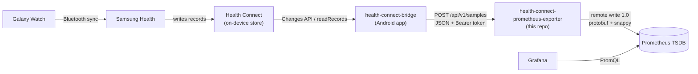
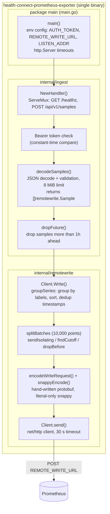
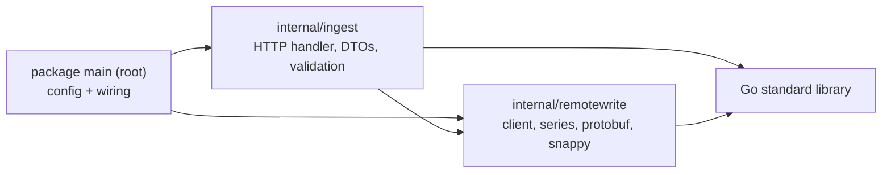
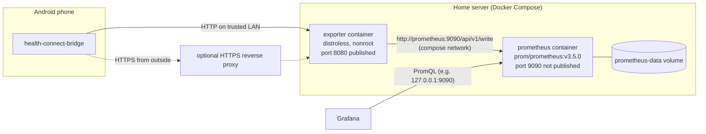
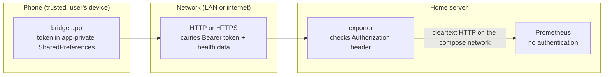

# Architecture

## System context

Health data travels from the watch to Grafana through two projects:
[health-connect-bridge](https://github.com/MateuxLucax/health-connect-bridge)
(Android app) and this exporter (Go server).

- The watch syncs to the phone late and in batches, so records reach Health
  Connect minutes or hours after they were measured.
- The app maps Health Connect records to Prometheus samples (metric name,
  labels, value, original timestamp) and owns the sync checkpoint.
- The exporter validates samples and forwards them with remote write, keeping
  the original timestamps. It holds no state.
- Prometheus must accept out-of-order samples
  (`out_of_order_time_window`, 30d in the example config).

## Components

One binary. `package main` at the repository root reads the configuration and
wires two packages under `internal/` together
([ADR 0012](adr/0012-code-structure.md)).

### Import rule

- `main` → `ingest` → `remotewrite` → standard library. Never the other way.
- `remotewrite` knows nothing about the app's JSON contract. It exports only
  `Sample`, `Client`, `NewClient`, `(*Client).Write` and `RejectedError`.
- `ingest` owns the app contract ([data.md](data.md)). It exports only
  `NewHandler`, which takes the concrete `*remotewrite.Client` (no interface).
- `main` holds no logic beyond the configuration checks.

| File | Responsibility |
|------|----------------|
| `main.go` | Configuration from the environment, `http.Server` timeouts, wiring |
| `internal/ingest/handler.go` | Routing, auth, future-sample filter, status mapping, logging |
| `internal/ingest/request.go` | JSON request DTO (decoding only), validation and limits; `decodeSamples` returns `[]remotewrite.Sample` |
| `internal/remotewrite/client.go` | `Client`, `RejectedError`, batching, rejected-sample isolation, upstream HTTP |
| `internal/remotewrite/series.go` | `Sample` input, grouping into series, splitting into batches |
| `internal/remotewrite/protobuf.go` | Hand-written `WriteRequest` protobuf encoder |
| `internal/remotewrite/snappy.go` | Literal-only snappy block encoder |
| `internal/*/*_test.go` | Unit tests per package (white-box). Each package has its own copy of the few helpers it needs |
| `spec_test.go` | Black-box specification tests through `ingest.NewHandler` and `remotewrite.NewClient`: a fake Prometheus decodes requests with an independent snappy/protobuf decoder |
| `integration_test.go` | The compiled binary against a real Prometheus (build tag `integration`) |

## Deployment

- Image: `ghcr.io/mateuxlucax/health-connect-prometheus-exporter`, multi-arch
  (`linux/amd64`, `linux/arm64`), built by CI from the `Dockerfile` (static
  `CGO_ENABLED=0` binary on `distroless/static-debian12:nonroot`).
- `docker-compose.example.yml` runs the exporter and Prometheus. Prometheus
  starts with `--web.enable-remote-write-receiver` and
  `--storage.tsdb.retention.time=10y`, and mounts `prometheus.yml`
  (`out_of_order_time_window: 30d`).
- `GET /healthz` returns `200 ok` for container health checks.

## Trust boundaries

| Boundary | Control |
|----------|---------|
| Phone to exporter | `Authorization: Bearer <AUTH_TOKEN>` checked with `crypto/subtle.ConstantTimeCompare` on every `POST /api/v1/samples` before the body is read. Wrong or missing token: `401`. `/healthz` is unauthenticated and returns no data. |
| Transport | The exporter speaks plain HTTP only; it has no TLS. The app allows cleartext (`usesCleartextTraffic="true"`) for LAN use. Outside a trusted LAN, put the exporter behind an HTTPS reverse proxy. |
| Token strength | The server refuses to start with an `AUTH_TOKEN` shorter than 32 characters. |
| Input | Body limited to 8 MiB; metric and label names validated; at most 16 labels of at most 1024 bytes each; label names starting with `__` rejected, so clients cannot set `__name__` or other reserved labels. |
| Exporter to Prometheus | Cleartext HTTP on the compose network. Prometheus has no authentication, so the example does not publish its port. Credentials in `REMOTE_WRITE_URL` are redacted in the startup log. |
