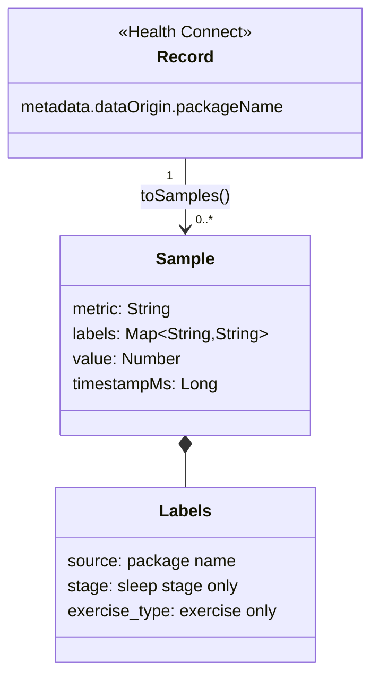
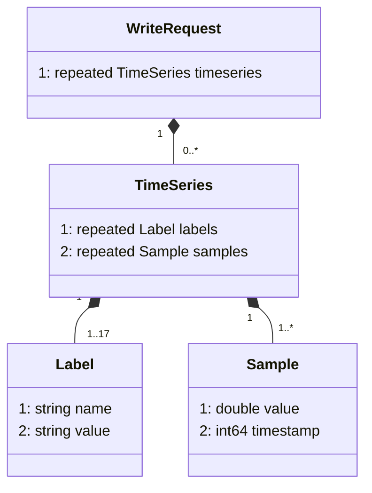
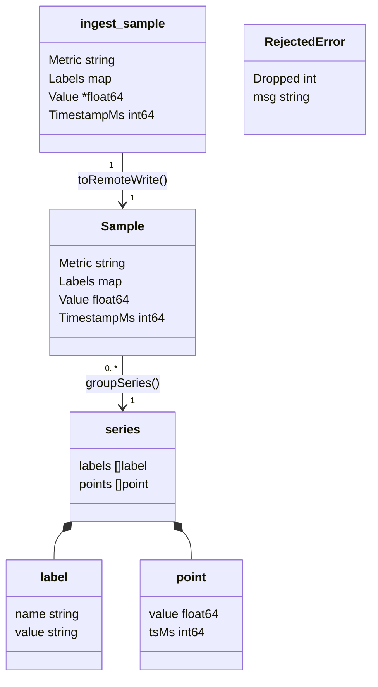

# Data structures

- [HTTP API contract](#http-api-contract)
- [Metric catalog](#metric-catalog)
- [Remote write payload](#remote-write-payload)

## HTTP API contract

This contract is shared by the exporter (`internal/ingest`) and the app
(`Uploader.kt`).

### `POST /api/v1/samples`

Headers: `Authorization: Bearer <AUTH_TOKEN>`, `Content-Type: application/json`.

```json
{
  "samples": [
    {
      "metric": "health_heart_rate_bpm",
      "labels": {"source": "com.sec.android.app.shealth"},
      "value": 72,
      "timestamp_ms": 1792839600000
    }
  ]
}
```

Equivalent JSON Schema (the server checks these rules in code):

```json
{
  "type": "object",
  "required": ["samples"],
  "properties": {
    "samples": {
      "type": "array",
      "items": {
        "type": "object",
        "required": ["metric", "value", "timestamp_ms"],
        "properties": {
          "metric": {"type": "string", "pattern": "^[a-zA-Z_:][a-zA-Z0-9_:]*$"},
          "labels": {
            "type": "object",
            "maxProperties": 16,
            "propertyNames": {"pattern": "^[a-zA-Z_][a-zA-Z0-9_]*$", "not": {"pattern": "^__"}},
            "additionalProperties": {"type": "string", "maxLength": 1024}
          },
          "value": {"type": "number"},
          "timestamp_ms": {"type": "integer", "exclusiveMinimum": 0}
        }
      }
    }
  }
}
```

Field rules:

| Field | Rule |
|-------|------|
| body | At most 8 MiB. Exactly one JSON value; trailing data is a `400`. Unknown fields are ignored. A missing or empty `samples` list is valid. |
| `metric` | Prometheus metric name, `^[a-zA-Z_:][a-zA-Z0-9_:]*$`. |
| `labels` | Optional. At most 16. Names match `^[a-zA-Z_][a-zA-Z0-9_]*$` and must not start with `__`. Values at most 1024 bytes. Empty values are dropped (Prometheus treats empty as absent). |
| `value` | Required JSON number (`float64`). |
| `timestamp_ms` | Unix time in milliseconds, `> 0`. Samples more than 1 hour after the server's clock are dropped and logged, not rejected. |
| duplicates | Several samples of the same series with the same timestamp: the last one in the request wins. |

Client-side limits (app): at most 5,000 samples per request, 15 s connect
timeout, 60 s read timeout. The server splits each request into remote write
batches of at most 10,000 points.

### Status codes

| Status | Meaning | What the client does |
|--------|---------|----------------------|
| `204` | Written. Also returned when Prometheus rejected some samples with `400` (too old, duplicate timestamp with a different value): those were dropped for good and the rest written. Also for an empty list (used as a connection test). | Advance the checkpoint. |
| `400` | Malformed JSON, body over 8 MiB, or a sample breaks a rule above. Body: short reason. Nothing was written. | Do not advance; show the error. Retrying the same data will not help. The app ends the run with `Result.failure()` and shows the message. |
| `401` | Missing or wrong token. Nothing was read or written. | Do not advance; show "token rejected". The app ends the run with `Result.failure()`. |
| `502` | Prometheus unreachable, timed out, or answered anything other than 2xx/400 (404 receiver disabled or wrong path, 401/403 from a proxy, 413, 429, 5xx). Some batches may already be written. | Do not advance; retry later with the same data. The app returns `Result.retry()` (WorkManager backoff). |

Other routes answer `404`; a wrong method on a known route answers `405`.

### `GET /healthz`

Unauthenticated. Returns `200` with body `ok`.

## Metric catalog

The app maps Health Connect records to samples (`Metrics.kt` in
health-connect-bridge); the exporter forwards whatever valid samples it
receives. This table is identical in both repositories' docs.

Every sample has a `source` label: the package name of the app that wrote the
record (for example `com.sec.android.app.shealth`). No aggregation happens on
the phone: one record (or one sub-sample, stage or delta of it) becomes one
sample.

| Health Connect record | Metric | Value (unit) | Timestamp | Extra labels |
|---|---|---|---|---|
| `HeartRateRecord` (each sample) | `health_heart_rate_bpm` | beats per minute | sample time | |
| `RestingHeartRateRecord` | `health_resting_heart_rate_bpm` | beats per minute | time | |
| `HeartRateVariabilityRmssdRecord` | `health_heart_rate_variability_rmssd_ms` | ms | time | |
| `OxygenSaturationRecord` | `health_oxygen_saturation_percent` | % | time | |
| `RespiratoryRateRecord` | `health_respiratory_rate_breaths_per_minute` | breaths/min | time | |
| `SkinTemperatureRecord` (each delta) | `health_skin_temperature_delta_celsius` | delta, °C | delta time | |
| `StepsRecord` | `health_steps` | count in interval | start time | |
| `DistanceRecord` | `health_distance_meters` | meters in interval | start time | |
| `ActiveCaloriesBurnedRecord` | `health_active_calories_kcal` | kcal in interval | start time | |
| `TotalCaloriesBurnedRecord` | `health_total_calories_kcal` | kcal in interval | start time | |
| `SleepSessionRecord` (each stage) | `health_sleep_stage_seconds` | stage duration, s | stage start time | `stage`: `awake`, `sleeping`, `out_of_bed`, `light`, `deep`, `rem`, `awake_in_bed`, `unknown` |
| `SleepSessionRecord` | `health_sleep_session_seconds` | session duration, s | end time | |
| `ExerciseSessionRecord` | `health_exercise_session_seconds` | session duration, s | start time | `exercise_type`: lowercase name of the `EXERCISE_TYPE_*` constant (e.g. `running`), or the number if unknown |
| `WeightRecord` | `health_weight_kg` | kg | time | |
| `BodyFatRecord` | `health_body_fat_percent` | % | time | |
| `Vo2MaxRecord` | `health_vo2_max_ml_per_kg_min` | ml/kg/min | time | |

- Interval metrics (steps, distance, calories) are the amount in the
  interval, stamped at the interval start; sum them with `sum_over_time`
  (see [ADR 0009](https://github.com/MateuxLucax/health-connect-prometheus-exporter/blob/main/docs/adr/0009-interval-metrics-at-interval-start.md)).
- `SkinTemperatureRecord` is only read when the device's Health Connect
  supports it (`FEATURE_SKIN_TEMPERATURE`).
- Only types the user granted read permission for are read.



## Remote write payload

`internal/remotewrite` hand-encodes a remote write 1.0 `prometheus.WriteRequest`
(no generated code, no protobuf library). Only the fields below are written;
metadata and exemplars are not used.



| Message | Field | Wire type | Encoding |
|---------|-------|-----------|----------|
| `WriteRequest` | 1 `timeseries` | 2 (length-delimited) | one per series in the batch |
| `TimeSeries` | 1 `labels` | 2 | `__name__` plus the sample labels, sorted by name, empty values removed |
| `TimeSeries` | 2 `samples` | 2 | sorted by timestamp, unique timestamps |
| `Label` | 1 `name`, 2 `value` | 2 | raw UTF-8 bytes |
| `Sample` | 1 `value` | 1 (fixed64) | IEEE 754 bits, little endian |
| `Sample` | 2 `timestamp` | 0 (varint) | Unix milliseconds |

Each tag is the varint `field << 3 | wire_type`; length-delimited fields are
followed by a varint length.

### Snappy

The protobuf bytes are compressed in the snappy **block** format (not the
framed/stream format), as remote write requires. `snappyEncode` writes only
literal elements, which is valid snappy that any decoder accepts, just not
smaller:

```
varint(uncompressed length)
literal* : each covers up to 64 KiB of input
  tag byte = (len-1) << 2            when len-1 < 60
  tag byte = 60..63 << 2, then len-1 in 1..4 little-endian bytes
  followed by the literal bytes
```

### Upstream request

```
POST {REMOTE_WRITE_URL}
Content-Encoding: snappy
Content-Type: application/x-protobuf
X-Prometheus-Remote-Write-Version: 0.1.0
```

At most 10,000 points per request; 30 s client timeout; up to 4 KiB of the
response body is read for the log message. Status mapping: 2xx success,
`400` rejected samples (isolated and dropped), anything else an error that
becomes `502` for the app.

### In-memory model

`ingest_sample` is the JSON DTO `sample` in `internal/ingest`: its `Value` is a
pointer so a missing value is told apart from `0`. After validation it becomes
a `remotewrite.Sample`. `Sample`, `series`, `label`, `point` and
`RejectedError` live in `internal/remotewrite`; only `Sample` and
`RejectedError` are exported.


