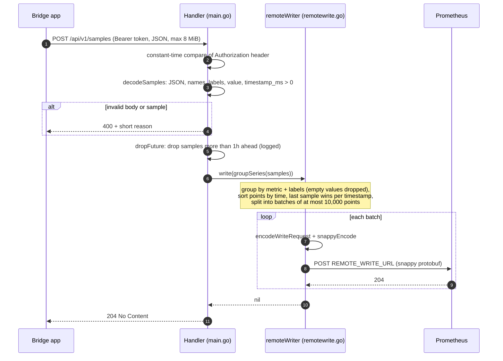
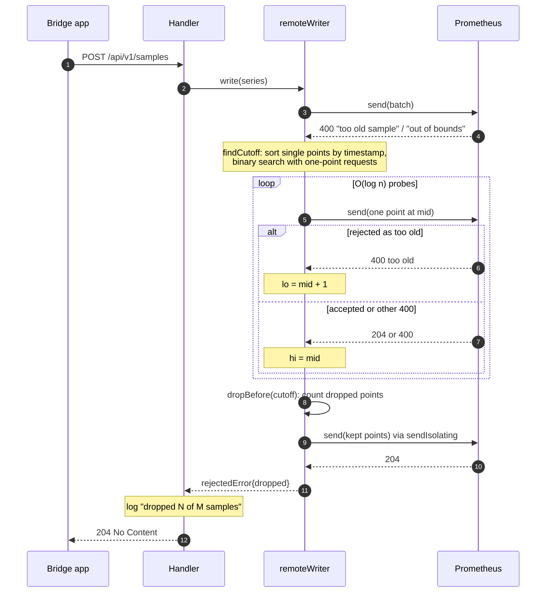
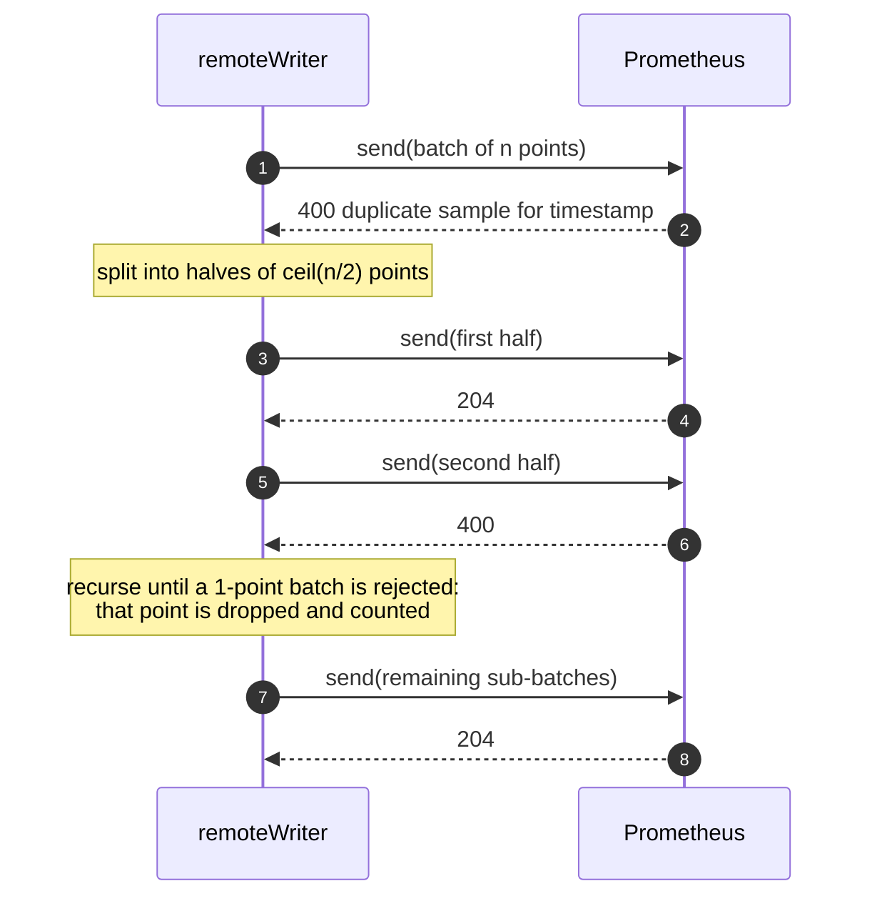
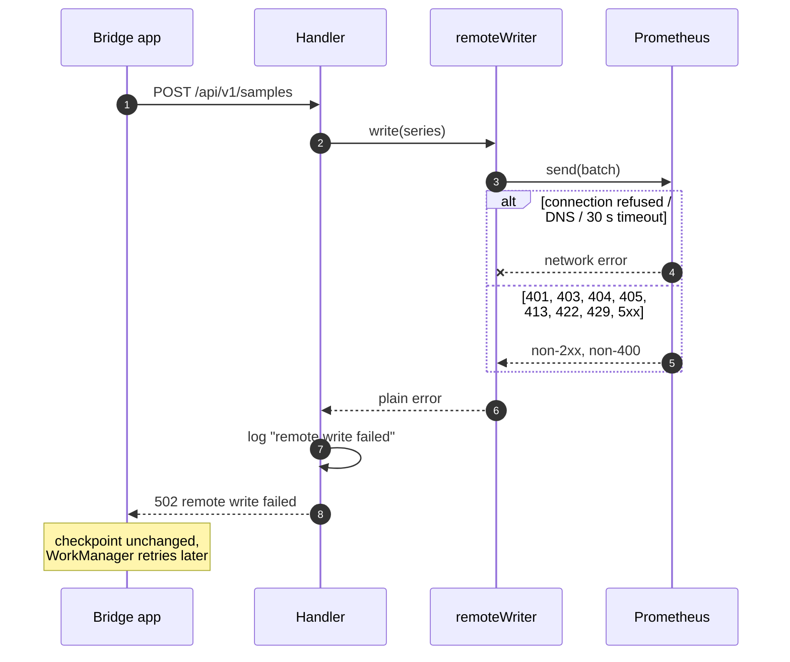
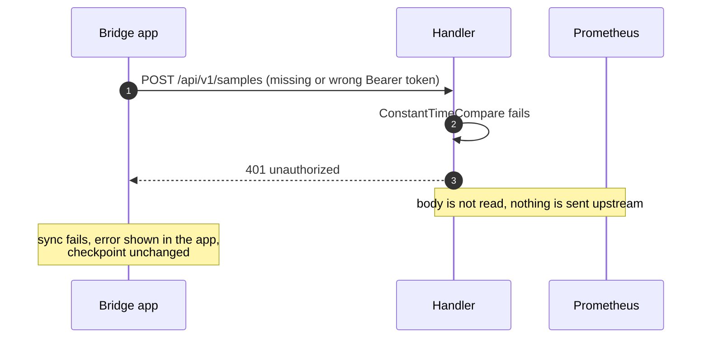
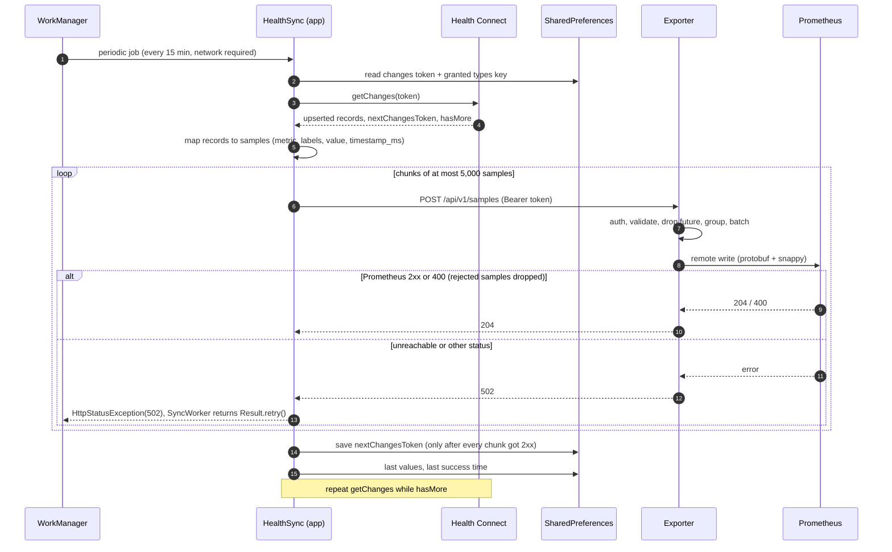

# Sequences

- [Normal request](#normal-request)
- [Partial rejection](#partial-rejection)
- [Upstream misconfigured or unreachable](#upstream-misconfigured-or-unreachable)
- [Authentication failure](#authentication-failure)
- [End to end: app, exporter, Prometheus](#end-to-end-app-exporter-prometheus)

## Normal request

An empty `samples` list produces no upstream request and returns `204`.

## Partial rejection

Prometheus discards a whole remote write request when one sample in it is
rejected (`400`). The exporter isolates the offending samples, resends the
rest and still answers `204`. Too-old samples are found with a binary search
on the timestamp cutoff; other `400`s are isolated by halving.

For a `400` that is not "too old" (for example "duplicate sample for
timestamp"), or when no point is too old on its own:

If any probe or resend gets a non-`400` error, the whole request fails with
`502` (next section).

## Upstream misconfigured or unreachable

Only `400` from Prometheus means "these samples are rejected for good".
Everything else fails the request so the app keeps its checkpoint and
retries.

Batches already written before the failure stay in Prometheus. The retry
resends them; Prometheus keeps the stored value for an existing timestamp
(a different value is a `400`, which is dropped), so retries are safe.

## Authentication failure

## End to end: app, exporter, Prometheus

The same diagram appears in the
[bridge docs](https://github.com/MateuxLucax/health-connect-bridge/blob/main/docs/sequences.md#end-to-end-app-exporter-prometheus).

